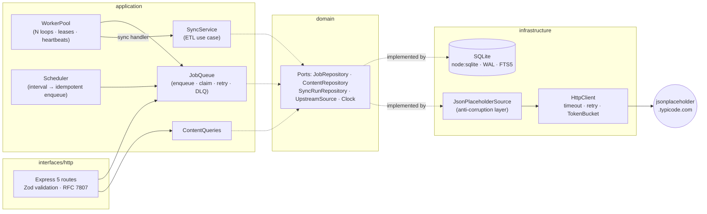
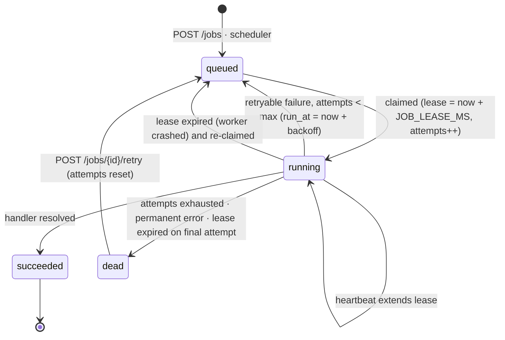

# Content Sync Engine


A background job-processing and ETL service written in TypeScript. It pulls users, posts, comments and todos from [JSONPlaceholder](https://jsonplaceholder.typicode.com), stores them in SQLite, and serves the synced data and job management over a REST API.

The main part of the project is a **durable job queue built on SQLite, with no external libraries**. It has lease-based claiming, crash recovery, retries with exponential backoff, dead-lettering, priorities and idempotency keys. Everything runs with **no external infrastructure**: no Redis, no Postgres and no Docker needed. You only need Node.js.

## Highlights

- **Hexagonal architecture**: domain ports, application use cases, and swappable infrastructure adapters, all wired up in one composition root.
- **Durable queue**: one atomic `UPDATE … RETURNING` claim, visibility-timeout leases with heartbeats, fencing against stale workers, retries with jittered exponential backoff, dead-letter status and manual retry.
- **ETL with audit trail**: full and incremental (high-water mark) sync, hash-based change detection, transactional upserts, pruning with a safety valve, and a `sync_runs` record for every resource sync.
- **Polite outbound HTTP**: timeout and retry for each attempt, `Retry-After` support, and a token-bucket rate limiter shared by all workers.
- **Production-ready API**: keyset pagination, FTS5 full-text search, a no-N+1 detail endpoint, SQL aggregations, RFC 7807 errors, request IDs, OpenAPI docs and graceful shutdown.
- **99 tests** (Vitest + supertest). The tests never touch the network.

## Architecture



The domain layer depends on nothing. The application layer depends only on domain ports. Concrete classes are created only in [`src/composition-root.ts`](src/composition-root.ts). This is why the integration tests can swap in an in-memory upstream and an in-memory database without any mocking framework.

### Job lifecycle



## Design decisions

**Lease-based claiming instead of row locks.** SQLite has no `SELECT … FOR UPDATE SKIP LOCKED`. A worker claims a job with a single statement, `UPDATE jobs SET status='running', locked_by=?, locked_until=now+lease, attempts=attempts+1 WHERE id = (SELECT … ORDER BY priority DESC, run_at LIMIT 1) RETURNING *`, run inside `BEGIN IMMEDIATE`. SQLite allows only one writer at a time, so two workers can never claim the same row. While a handler runs, it renews the lease every `lease/3`. If the process dies, the lease expires and any worker can pick the job up again. Every completion, failure and heartbeat includes `AND locked_by = :me`. This acts as a **fencing token**: a worker that lost its lease (for example, after a long GC pause) cannot overwrite the result of the worker that took over. When a job's lease expires on its final attempt, the job is moved to `dead` instead of being handed out forever (a "poison pill" job).

**Idempotency keys.** `jobs.idempotency_key` is `UNIQUE`, and the insert is `ON CONFLICT DO NOTHING RETURNING *`, so concurrent duplicate requests resolve atomically in the database, not through a check-then-insert race. A replay returns the original job (`200`, `Idempotent-Replayed: true`). Reusing a key with a different body returns `422`, as `draft-ietf-httpapi-idempotency-key-header` specifies. The scheduler uses the same mechanism: its key is `schedule:<name>:<floor(now / interval)>`, so several instances (or a restart) never enqueue the same time slot twice.

**Backoff.** Retry delay is `min(max, base · 2^(attempt-1))` with _equal jitter_, meaning a random value in `[d/2, d]`. Jitter spreads out jobs that failed together during an upstream outage. The lower bound still guarantees a real pause. Errors are classified: `UpstreamError(retryable=false)` (4xx, schema drift), `ValidationError` and `PermanentJobError` skip retries and go straight to `dead`.

**Change detection.** Every row stores a SHA-1 of its normalised content. An upsert compares hashes and writes only rows that are new or changed, so a re-sync with no changes performs zero writes and does not touch the FTS index. Network I/O happens _outside_ the write transaction, so the write lock is held only for the local upsert.

**Incremental vs full sync.** JSONPlaceholder has no `updated_since`, so incremental sync uses a high-water mark: it fetches only `id >= max(id)+1`. Full sync also _prunes_ rows that disappeared upstream (deletes cascade through foreign keys). It refuses to prune when upstream returns an empty list, because that is more likely an upstream bug than a real mass deletion. Resources are always processed parent-first (`users → posts → comments → todos`). Rows whose parent is missing are counted as `skipped` instead of failing the batch on a foreign-key violation.

**Read side.** `GET /posts` uses keyset pagination on the primary key with an opaque cursor. This is stable under concurrent inserts and takes O(limit) at any depth. Search uses an external-content FTS5 table that triggers keep in sync. User input is tokenised and quoted, so it can never inject FTS operators. `GET /posts/:id` returns the author (JOIN) and comments (`json_group_array(… ORDER BY id)`) in a **single query**, with no N+1.

**Why `node:sqlite`.** It is built into Node, so there is no native addon to compile on each platform or Node version. It is synchronous, which suits SQLite's single-writer model, and it ships with FTS5, JSON1 and `RETURNING`. It is unflagged from Node 22.13 onward. The `--disable-warning=ExperimentalWarning` flag in the scripts only silences the stability banner. Swapping the database means implementing four repository interfaces.

## API

Interactive docs: **`/docs`** (Swagger UI). Raw spec: [`openapi.yaml`](openapi.yaml), also served at `/openapi.json`.

| Method | Path                 | Description                                                                       |
| ------ | -------------------- | --------------------------------------------------------------------------------- |
| GET    | `/posts`             | List posts. `limit` (1–100), `cursor`, `userId`, `q` (full-text search)           |
| GET    | `/posts/:id`         | Post with author and comments (single query)                                      |
| GET    | `/users/:id/stats`   | Post, comment and todo aggregates and the most-commented post, computed in SQL    |
| POST   | `/jobs`              | Enqueue a job. Supports the `Idempotency-Key` header. `202` created, `200` replay |
| GET    | `/jobs`              | List jobs (newest first). `status`, `type`, `limit`, `cursor`                     |
| GET    | `/jobs/stats`        | Job counts by status                                                              |
| GET    | `/jobs/:id`          | Job details, including `attempts`, `lastError` and `result`                       |
| POST   | `/jobs/:id/retry`    | Re-queue a `dead` job (`409` if it is not dead)                                   |
| GET    | `/sync-runs`         | Sync audit log. `jobId`, `resource`, `status`, `limit`, `cursor`                  |
| GET    | `/health` / `/ready` | Liveness / readiness (database, workers, shutdown state)                          |

Job body:

```json
{
  "type": "sync",
  "payload": { "mode": "full", "resources": ["users", "posts"] },
  "priority": 10,
  "maxAttempts": 5,
  "delayMs": 0
}
```

Every field except `type` is optional. `mode` defaults to `incremental` and `resources` defaults to all four.

Errors follow RFC 7807:

```json
{
  "type": "urn:content-sync-engine:problem:validation-error",
  "title": "Validation Failed",
  "status": 400,
  "detail": "Invalid request query",
  "instance": "/posts?limit=0",
  "errors": [{ "path": "query.limit", "message": "Too small: expected number to be >=1" }],
  "requestId": "91fbff56-e310-4e26-bab4-267cfc66f2d3"
}
```

## Quick start

```bash
npm install
npm run dev            # tsx watch, http://localhost:3000, docs at /docs
```

```bash
# enqueue a full sync (idempotent)
curl -X POST localhost:3000/jobs \
  -H 'content-type: application/json' -H 'Idempotency-Key: first-full-sync' \
  -d '{"type":"sync","payload":{"mode":"full"}}'

curl localhost:3000/jobs/<id>                  # wait for "status": "succeeded"
curl 'localhost:3000/posts?limit=2'
curl 'localhost:3000/posts?q=dolorem&userId=1'
curl localhost:3000/users/1/stats
curl localhost:3000/sync-runs
```

Production build:

```bash
npm run build && npm start
# or
docker compose up --build
```

The Docker image is multi-stage, runs as the non-root `node` user, has a `HEALTHCHECK` on `/ready`, and keeps the database on a volume at `/app/data`.

## Configuration

All configuration comes from environment variables, validated with Zod at startup (the process fails fast on bad values). See [`.env.example`](.env.example). `npm run dev` and `npm start` load `.env` automatically if it exists.

| Variable                                                 | Default                                | Description                                           |
| -------------------------------------------------------- | -------------------------------------- | ----------------------------------------------------- |
| `PORT` / `HOST`                                          | `3000` / `0.0.0.0`                     | HTTP listener                                         |
| `LOG_LEVEL` / `LOG_PRETTY`                               | `info` / `false`                       | pino level; pretty output for development             |
| `DATABASE_PATH`                                          | `./data/content-sync.db`               | SQLite file (`:memory:` supported)                    |
| `UPSTREAM_BASE_URL`                                      | `https://jsonplaceholder.typicode.com` | Source API                                            |
| `UPSTREAM_TIMEOUT_MS` / `UPSTREAM_MAX_RETRIES`           | `10000` / `3`                          | Per-attempt timeout and retry budget                  |
| `UPSTREAM_RATE_LIMIT_RPS` / `UPSTREAM_RATE_LIMIT_BURST`  | `5` / `10`                             | Token bucket shared by the whole process              |
| `WORKERS_ENABLED` / `WORKER_CONCURRENCY`                 | `true` / `2`                           | Run workers in this process; number of parallel loops |
| `WORKER_POLL_INTERVAL_MS`                                | `500`                                  | Idle poll interval (enqueue also wakes workers)       |
| `JOB_LEASE_MS`                                           | `30000`                                | Visibility timeout before a running job is re-claimed |
| `JOB_MAX_ATTEMPTS`                                       | `5`                                    | Default attempt budget before dead-lettering          |
| `JOB_BACKOFF_BASE_MS` / `JOB_BACKOFF_MAX_MS`             | `1000` / `60000`                       | Exponential backoff bounds                            |
| `SCHEDULER_ENABLED`                                      | `true`                                 | Enqueue periodic syncs                                |
| `INCREMENTAL_SYNC_INTERVAL_MS` / `FULL_SYNC_INTERVAL_MS` | `300000` / `3600000`                   | Schedule periods (`0` disables)                       |
| `SHUTDOWN_TIMEOUT_MS`                                    | `15000`                                | Maximum time to drain in-flight jobs on SIGTERM       |

### Graceful shutdown

On `SIGTERM`/`SIGINT` the service shuts down in this order:

1. `/ready` starts returning `503`.
2. The HTTP server stops accepting connections.
3. The scheduler stops.
4. Workers stop claiming and wait for in-flight jobs, up to `SHUTDOWN_TIMEOUT_MS`.
5. Jobs still running after that are aborted. Their leases expire and another instance retries them.
6. The database is closed.

A hard-exit timer guards against hangs.

## Testing

```bash
npm test          # vitest run
npm run lint      # ESLint (typescript-eslint, type-aware)
npm run typecheck
npm run build
```

- **Unit tests** cover queue semantics (priority ordering, backoff and its cap, dead-lettering, permanent errors, lease expiry and re-claim, fencing of stale workers, heartbeats, poison-pill handling, idempotency conflicts), the worker pool (concurrency limit, drain on stop, abort on timeout, wake-on-enqueue), the token bucket (driven by a manual clock), the HTTP client (retries, `Retry-After`, timeouts), repositories (against in-memory SQLite: hash-based upserts, cascades, transaction rollback, FTS sync, stats), the sync service and the scheduler.
- **Integration tests** drive the real Express app with supertest. The real SQLite database is used, and the upstream is replaced with an in-memory `FakeUpstream`, so **no test touches the network**. Jobs run deterministically with `workers.runOnce()`.
- Time-dependent logic takes an injected `Clock`, so lease-expiry and rate-limit tests are exact and never sleep.

CI (GitHub Actions) runs lint, format check, typecheck, tests and build on Node 22 and 24, then builds the Docker image.

## Project structure

```
src/
├── domain/              # entities, job model, errors, ports (interfaces). No dependencies.
├── application/
│   ├── queue/           # JobQueue (semantics) + WorkerPool (execution)
│   ├── sync/            # SyncService (ETL use case) + "sync" job handler
│   ├── queries/         # read-side use cases
│   └── scheduler.ts     # interval → idempotent enqueue
├── infrastructure/
│   ├── db/              # node:sqlite wrapper, migrations + runner, repositories
│   └── http/            # HttpClient, TokenBucket, JsonPlaceholderSource
├── interfaces/http/     # Express app, routes, Zod schemas, RFC 7807 errors, request IDs
├── shared/              # clock, backoff, cursors, logger
├── composition-root.ts  # dependency wiring
├── lifecycle.ts         # graceful shutdown
└── server.ts            # entry point
test/
├── unit/                # queue, worker pool, rate limiter, HTTP client, repositories, sync, scheduler
├── integration/         # HTTP API end to end with a fake upstream
└── helpers/
```

## License

[MIT](LICENSE) © 2026 Yusuf Yuldashev
